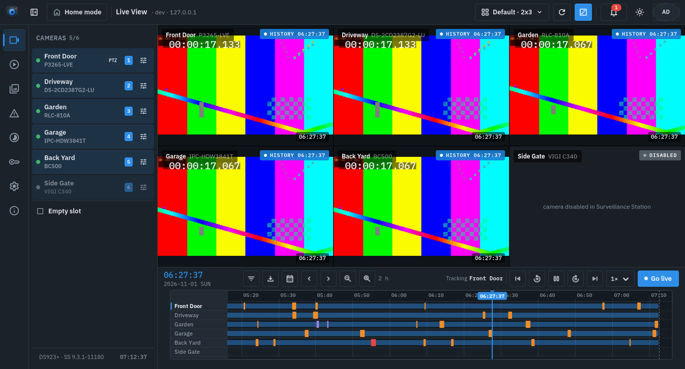

<p align="center">
  
</p>

# Synoptic

A native Linux desktop client for Synology Surveillance Station, written in
Rust with GTK4 and GStreamer.

Synoptic talks to the NAS over the same Web API and MixStream WebSocket the
official clients use, and decodes H.264 and H.265 in hardware through VAAPI,
so cameras the browser UI refuses to play work here.



**Status:** alpha. The full application builds and its unit tests pass, but it
has not yet been exercised against a real NAS. Expect rough edges.

## Features

- Live View: any grid from 1×1 to 4×4 (2×3, 3×2, …) plus 1+5 and 1+7 shapes,
  several named layouts per NAS, drag and drop between the camera list and
  slots, double-click a camera to fill the view with it (and its timeline
  lane alone) and again to return, PTZ pad with presets, snapshots, audio.
- Timeline under the grid: one lane per camera with recordings and
  colour-coded motion, alarm and manual events, 5 min to 24 h zoom, pan back
  through days, click or drag to seek every slot, event filter, date picker,
  download, and history playback that continues across recording files.
- Recordings, Events, Snapshots and Time Lapse browsing with filters,
  thumbnails, a player and downloads.
- Login with OTP and trusted devices, credentials in the Secret Service
  keyring, Home Mode toggle, alert notifications, licenses, dark and light
  themes.

## Building

Debian/Ubuntu dependencies:

```
sudo apt install libgtk-4-dev libgstreamer1.0-dev libgstreamer-plugins-base1.0-dev \
  gstreamer1.0-gtk4 gstreamer1.0-plugins-good gstreamer1.0-plugins-bad \
  gstreamer1.0-vaapi gstreamer1.0-libav gstreamer1.0-tools libfontconfig-dev
```

Then:

```
cargo run -p synoptic                # the GTK app
cargo run -p ss-cli -- --help        # headless test tool (login, cameras, live, history, …)
RUST_LOG=synoptic=debug,ss_stream=debug cargo run -p synoptic   # with logs
```

Linux is the primary target. The tree also compiles on macOS (Homebrew
`gtk4 gstreamer`) and Windows (MSYS2 UCRT64 `gtk4 gstreamer
gst-plugins-base`), with credentials in the Keychain / Credential Manager,
but neither is packaged yet, and the `ss` CLI (mpv over a Unix socket) is
Linux/macOS only. On Windows, `tools/windows/setup.ps1` installs MSYS2 and
builds a release binary (`tools/windows/build.sh run` starts it with logs
from the UCRT64 shell).

## Installing

```
tools/install.sh            # release build → ~/.local/bin, desktop entry + icon → ~/.local/share
tools/install.sh --uninstall
```

Even without installing, the app writes its launcher entry and icon under
`~/.local/share` the first time it runs (pointing at the binary that ran), so
`cargo run -p synoptic` also gets a window icon and a launcher entry. The
desktop entry is `io.github.darious.Synoptic.desktop`; the app icon and its
symbolic variant live in `crates/synoptic/data/icons/`.

## Developing without a NAS

`cargo run -p fake-nas` serves a synthetic Surveillance Station on
`http://127.0.0.1:5000` (user `admin`, password `admin`): six cameras, two
days of recordings with motion and alarm events, live and history video over
the real MixStream protocol. Log Synoptic in with HTTPS off, or use the CLI.

On a headless machine `tools/ui.sh` runs the app on GTK's Broadway backend and
drives it through `crates/synoptic/src/driver.rs` (page switching, layouts,
seeking, clicks by widget name, PNG screenshots).

## Repository layout

| Path | Contents |
|---|---|
| `crates/synoptic` | GTK4 application |
| `crates/ss-api` | Synology Web API client (auth, cameras, recordings, events, PTZ, …) |
| `crates/ss-stream` | MixStream WebSocket client and frame parser |
| `crates/ss-play` | `FrameSink` trait and mpv/ffmpeg subprocess sinks |
| `crates/ss-config` | profiles, settings and keyring secrets |
| `crates/ss-cli` | `ss` command-line tool |
| `crates/fake-nas` | offline stand-in NAS for development and tests |
| `docs/architecture.md` | teardown of the official Windows client and the protocol notes derived from it |
| `tools/` | stdlib-only NSIS and asar extractors used for the teardown |

## Protocol knowledge and trademarks

Synoptic is an independent project, not affiliated with or endorsed by
Synology Inc. Synology, DiskStation and Surveillance Station are trademarks of
Synology Inc. No Synology code or assets are included; the protocol was
documented by static analysis of the official client for interoperability
and cross-checked against the BSD-2 licensed
[renaudallard/surveillance-station-client](https://github.com/renaudallard/surveillance-station-client).
See `NOTICE` for attributions.

## License

GNU Affero General Public License v3.0 or later. See `LICENSE`. Third-party
credits (the BSD-2 reference client, Material Symbols icons) are in `NOTICE`.
